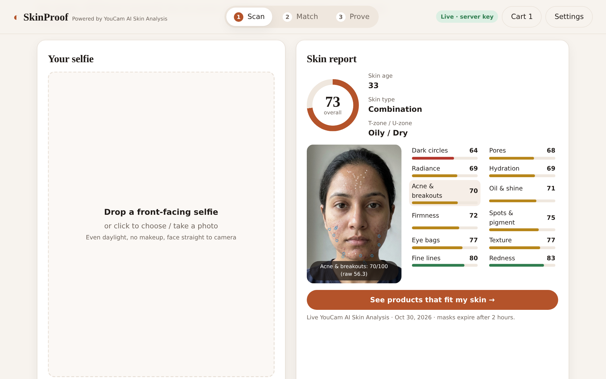
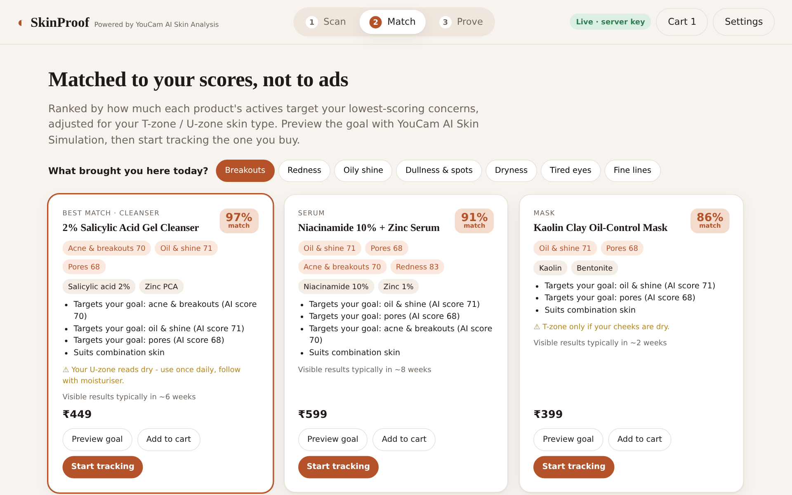
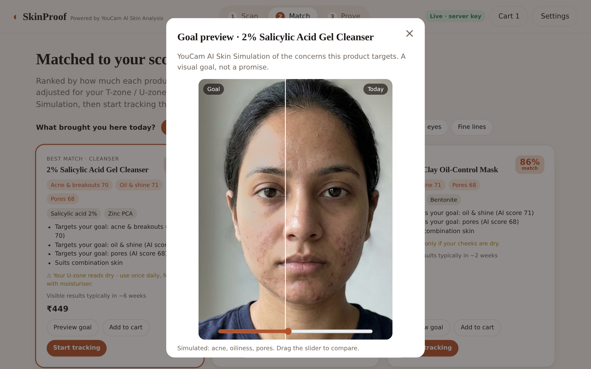
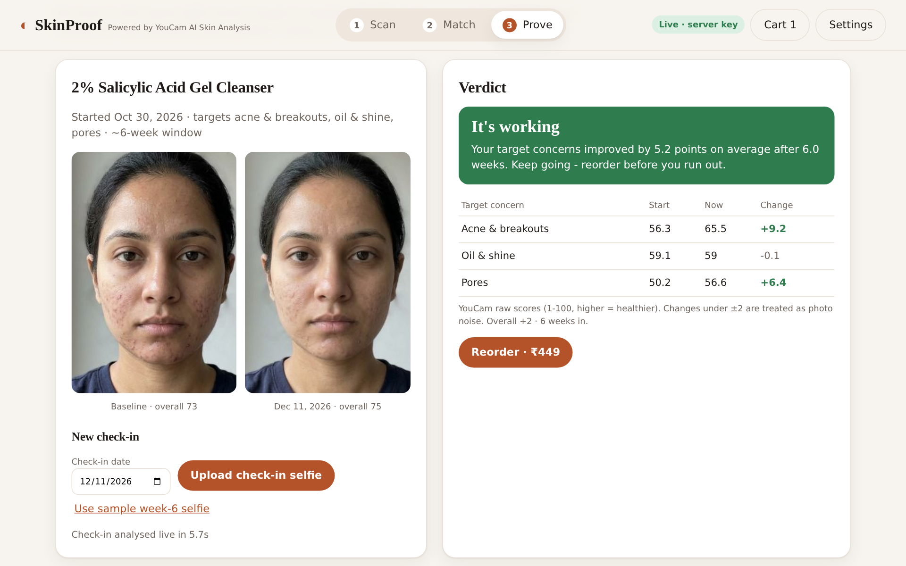

# ◐ SkinProof — is your skincare actually working?

**SkinProof** turns the YouCam AI Skin Analysis API into a buy → use → prove loop:

1. **Scan** – a guided selfie is analysed by **YouCam AI Skin Analysis** (12 concerns + T-zone/U-zone skin type, AI skin age, per-concern detection masks).
2. **Match** – products are ranked by how much their actives target *your* weakest scores and the goal you came in with, with zone-aware cautions (e.g. salicylic acid on a dry U-zone). **Preview goal** runs **YouCam AI Skin Simulation** on the concerns that product targets.
3. **Prove** – start tracking the product you bought. Each re-scan is compared on the product's target concerns (raw scores, ±2 noise band, per-active time-to-results window) and you get a straight verdict: *It's working · Too early to tell · Not doing much · Getting worse · Possible irritation* — with **Reorder** or **Switch to next-best match**.

> People don't wonder about their skin in the abstract — they wonder right before a purchase, and weeks later when deciding whether to buy the bottle again. SkinProof meets both moments.

| Skin report + masks | Goal-weighted matches |
|---|---|
|  |  |
| **Goal preview (Skin Simulation)** | **Verdict after 6 weeks** |
|  |  |

## YouCam APIs used

| API | Endpoint | Where |
|---|---|---|
| File API | `POST /s2s/v2.0/file` + PUT to pre-signed URL | every scan / preview |
| AI Skin Analysis (SD, 13 actions, `format: json`) | `POST /s2s/v2.0/task/skin-analysis`, `GET …/{task_id}` | Scan + every check-in (16 units) |
| AI Skin Simulation | `POST /s2s/v2.0/task/skin-simulation`, `GET …/{task_id}` | Match → Preview goal (4–6 units) |

Requested concerns: `acne, redness, oiliness, pore, texture, moisture, radiance, dark_circle_v2, eye_bag, wrinkle, age_spot, firmness, skin_type`.
API errors such as `error_src_face_too_small`, `error_pose` or `CreditInsufficiency` are translated into plain guidance; the cropper's oval guide keeps the face above the 60%-of-width requirement.

## Run it

Requires Node 18+. No dependencies, no build step.

```bash
git clone https://github.com/cryptocloud786/skinproof && cd skinproof
cp .env.example .env            # optional, for reference
export YOUCAM_API_KEY=sk-...    # your YouCam API key (kept server-side)
# India accounts (default):   https://yce-api-01.makeupar.com
# Global accounts:            export YOUCAM_API_HOST=https://yce-api-01.perfectcorp.com
npm start                       # -> http://localhost:8787
```

* **Server-key mode** – `server.js` serves the app and forwards only the File / Skin Analysis / Skin Simulation endpoints with your key. The key never reaches the browser.
* **Bring-your-own-key mode** – host the folder statically (e.g. GitHub Pages) and paste a key in **Settings** (stored only in your browser; sent only to the YouCam API, which allows CORS).
* **Demo mode** – with no key, the sample selfie replays **recorded responses from real YouCam API calls** (`demo/`), so judges can click through the whole flow without spending units.

Get a key: sign up at <https://yce.perfectcorp.com/ai-api> (India: <https://yce.makeupar.com/ai-api>) → API Keys.

## Project layout

```
index.html          single-page app (Scan / Match / Prove)
css/styles.css
js/youcam.js        YouCam client: upload, task start, polling, normalisation, error mapping
js/catalog.js       demo catalogue, goal-weighted ranking, simulation intensities, verdict engine
js/app.js           UI: cropper, report + mask viewer, matches, goal preview, tracking, cart
server.js           zero-dependency static server + allow-listed YouCam proxy
demo/               AI-generated sample selfies + recorded real API responses and masks
docs/               screenshots
```

## How the verdict works

* Compares **raw_score** (more sensitive than the calibrated ui_score) for the concerns the product claims to target.
* Average change ≥ +2 → **It's working**; ≤ −2 → **Getting worse**; a redness drop ≥ 4 → **Possible irritation**.
* Inside ±2 it checks time: under 60% of the active's typical window (e.g. 6 weeks for salicylic acid, 12 for retinal) → **Too early to tell** with a re-scan date; otherwise **Not doing much** → suggest the next-best match before you rebuy.

## Notes

* The sample face is AI-generated; the product list is a generic, unbranded demo catalogue with INR prices. Checkout is a demo.
* History is stored in `localStorage` on the user's device. Mask URLs from the API expire after ~2 hours.
* SkinProof is not medical advice.

Built for the **YouCam API Skin AI & eCommerce VTO Hackathon** (Skin AI track). MIT licensed.
